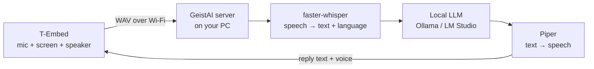

# GeistAI

**A multilingual, private voice assistant for the LilyGO T-Embed.**
You talk to the T-Embed. It shows and speaks the answer. Speech recognition, the language model and
the voice all run on your own computer, so nothing leaves your home network.


- Cursive **GeistAI** boot animation (the name "writes itself" with a glowing pen tip)
- Neon-cyan interface with chat bubbles, live mic meter, "thinking" and "speaking" states
- **Multilingual:** talk in German, English, Spanish, French, Italian, Portuguese, Dutch, Polish or
  Turkish. The language is detected automatically and the answer comes back in the same language.
  The menu itself is available in EN / DE / ES / FR.
- Push-to-talk *or* tap-to-talk with automatic end-of-speech detection
- LED ring effects for listening, thinking and speaking
- Runs on the **original T-Embed** and the **T-Embed CC1101**

## How it works



An ESP32-S3 cannot run a large language model, so the T-Embed is the "face" and your PC (or a
Raspberry Pi 5, NAS or home server) is the "brain". The two find each other automatically through mDNS.

## Quick start

### 1. Server (on your PC)

You need Python 3.10–3.13 (64-bit) and [Ollama](https://ollama.com). The speech engine (ctranslate2) has no packages for brand-new Python releases or for Windows on ARM yet; on Windows: `py install 3.13`, then `py -3.13 -m venv .venv`.

```bash
ollama pull gemma3:4b                 # any multilingual chat model works

cd server
python -m venv .venv && source .venv/bin/activate     # Windows: .venv\Scripts\activate
pip install -r requirements.txt
cp .env.example .env                  # optional: change models, voices, port
python -m geist_server.download_voices de en es       # Piper voices for the languages you want
python -m geist_server
```

On Windows you can afterwards just double-click **`server\start.bat`** to start the server.

Open <http://localhost:8765> to test it in the browser. You can also run everything with Docker:
`cp .env.example .env && docker compose up -d`.

Using **LM Studio** instead of Ollama? Set `LLM_BACKEND=openai` and `LLM_URL=http://localhost:1234`
in `.env`.

### 2. Firmware (on the T-Embed)

Install [PlatformIO](https://platformio.org/) (VS Code extension or CLI).

```bash
cd firmware
cp include/secrets.example.h include/secrets.h   # add your Wi-Fi name + password
pio run -e tembed -t upload            # original T-Embed
pio run -e tembed_cc1101 -t upload     # T-Embed CC1101
```

Leave `GEIST_SERVER_URL` empty to find the server automatically, or set it to
`http://<your-pc-ip>:8765`. If uploading fails, hold the **BOOT** button while plugging in USB.

## Controls

| Action                         | What happens                                        |
|--------------------------------|-----------------------------------------------------|
| **Hold** the knob              | Push-to-talk. Release to send                       |
| **Tap** the knob               | Opens the on-screen keyboard                        |
| Keyboard: **turn** the knob    | Moves the highlight over the keys                   |
| Keyboard: **tap** the knob     | Types the highlighted key (➤ sends, ✕ closes)       |
| Keyboard: **hold** the knob    | Switches to talking                                 |
| **Turn** the knob (chat)       | Scroll the conversation / change a setting          |
| Tap while it's speaking        | Stop the voice                                      |
| Back button (CC1101)           | Open or close settings (also the ⚙ key)             |
| **Hold** back button 3 s       | Switch off (hold it ~1 s to switch back on)         |

The keyboard has three pages: letters (QWERTZ with ä ö ü ß), numbers and symbols, and
accented letters (á é ñ ç …). ⇧ capitalises the next letter.

**Settings:** speech language (Auto or fixed), menu language, volume, voice replies on/off,
clear chat, device info (IP address).

## Project layout

```
firmware/            PlatformIO project (Arduino, ESP32-S3)
  include/board.h    pin maps for both T-Embed variants
  include/config.h   tunables: recording length, VAD, gains, timeouts …
  src/ui.cpp         all screens (pure rendering, also used by the simulator)
  src/gfx.cpp        tiny anti-aliased renderer + UTF-8 text
  src/audio.cpp      ES7210 / PDM mic, I2S speaker
  src/net.cpp        Wi-Fi, mDNS discovery, HTTP API, WAV streaming
  src/main.cpp       state machine, worker task, settings
server/              Python server (FastAPI + faster-whisper + Ollama + Piper)
tools/gen_assets.py  renders the cursive logo, fonts and icons into C headers
tools/sim/           desktop simulator: renders every screen to PNG
docs/protocol.md     HTTP API between device and server
```

Change the look and preview it without hardware:

```bash
python3 tools/gen_assets.py     # after changing fonts / logo
python3 tools/sim/render.py     # writes tools/sim/out/screens.png
```

## Status & roadmap

This is the first version (v0.1). The server pipeline has unit tests, and the screens are previewed
with the desktop simulator. CI builds the firmware for both boards on every push. The firmware has
not been tested on a real T-Embed yet. Planned:

- [ ] Wi-Fi setup through a captive portal (no `secrets.h` needed)
- [ ] Wake word ("Hey Geist") using the ESP32-S3's on-device wake-word engine
- [ ] Streaming replies (first words spoken while the LLM is still writing)
- [ ] Battery gauge for the T-Embed CC1101 (BQ27220)
- [ ] Tools: weather, timers, Home Assistant

## Credits

- Pin maps, panel init and the ES7210 driver come from LilyGO's
  [T-Embed](https://github.com/Xinyuan-LilyGO/T-Embed) and
  [T-Embed-CC1101](https://github.com/Xinyuan-LilyGO/T-Embed-CC1101) repositories (MIT).
- Fonts: [Dancing Script](https://fonts.google.com/specimen/Dancing+Script) and
  [Inter](https://rsms.me/inter/), SIL Open Font License.
- [faster-whisper](https://github.com/SYSTRAN/faster-whisper), [Ollama](https://ollama.com),
  [Piper](https://github.com/OHF-Voice/piper1-gpl), [LovyanGFX](https://github.com/lovyan03/LovyanGFX).

MIT License. See [LICENSE](LICENSE).
