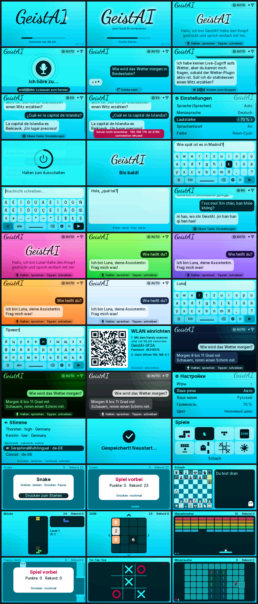
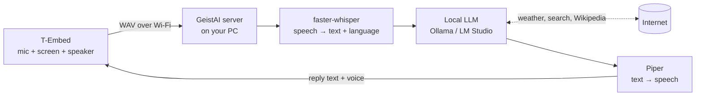

# GeistAI

**A multilingual, private voice assistant for the LilyGO T-Embed, M5Stack Cardputer and StickC Plus2.**
You talk to the device. It shows and speaks the answer. Speech recognition, the language model and
the voice all run on your own computer, so nothing leaves your home network.

**Install it from the browser:** <https://geisterjaeger02.github.io/GeistAI/> (Chrome or Edge on a computer)



- Cursive **GeistAI** boot animation (the name "writes itself" with a glowing pen tip)
- Neon-cyan interface with chat bubbles, live mic meter, "thinking" and "speaking" states, and
  13 colour themes (including three dark ones)
- **Games:** Snake, Chess (against GeistAI), Blocks, 2048, Breakout, Flappy Ghost, Tic-Tac-Toe
  and Minesweeper, with saved high scores
- **Multilingual:** talk in 28 languages: German, English, Spanish, French, Italian, Portuguese,
  Dutch, Polish, Turkish, Russian, Ukrainian, Czech, Slovak, Swedish, Danish, Norwegian, Finnish,
  Hungarian, Romanian, Greek, Catalan, Serbian, Arabic, Persian, Hindi, Chinese, Vietnamese and
  Indonesian. The language is detected automatically and the answer comes back in the same
  language, spoken by a matching voice (downloaded the first time you use a language). The
  screen shows Latin, Cyrillic and Greek; Chinese, Arabic, Persian and Hindi appear in Latin
  letters. Years are spoken the way people say them ("neunzehnhundertsechsunddreißig").
  The menu is available in English, German, Spanish, French, Italian, Portuguese, Dutch,
  Polish, Turkish and Russian.
- **Live answers from the internet:** weather and forecasts (Open-Meteo), web and news search
  (DuckDuckGo) and Wikipedia. No accounts or API keys needed
- Push-to-talk *or* tap-to-talk with automatic end-of-speech detection
- LED ring effects for listening, thinking and speaking
- Type instead of talking: on-screen keyboard (T-Embed) or the real keyboard (Cardputer)
- Wi-Fi setup without a computer: the device opens a hotspot and shows a QR code
- Runs on these boards:

| Board                  | Mic | Speaker | Keyboard        | Screen  |
|------------------------|-----|---------|-----------------|---------|
| LilyGO T-Embed CC1101  | ✓   | ✓       | on-screen       | 320×170 |
| LilyGO T-Embed         | ✓   | ✓       | on-screen       | 320×170 |
| M5Stack Cardputer      | ✓   | ✓       | real keys       | 240×135 |
| M5Stack StickC Plus2   | ✓   | –       | on-screen       | 240×135 |

Without a speaker the answers appear as text, and the server can read them out on your PC
(`SPEAK_ON_PC=1` in `.env`).

## How it works



An ESP32-S3 cannot run a large language model, so the T-Embed is the "face" and your PC (or a
Raspberry Pi 5, NAS or home server) is the "brain". The two find each other automatically through mDNS.

## Quick start

### 1. Install the firmware

Open the **[web flasher](https://geisterjaeger02.github.io/GeistAI/)** in Chrome or Edge, pick your
board, plug it in with a USB-C data cable and click **Install**. Right after installing, the
browser asks for your Wi-Fi.

If you skip that (or move house later), the device starts its own Wi-Fi hotspot
**GeistAI-XXXX** and shows a QR code. Scan it with your phone, and a setup page opens where you
enter your Wi-Fi and, optionally, the server address. You can open the hotspot again any time under
**Settings → Wi-Fi setup**.

<details>
<summary>Building it yourself with PlatformIO</summary>

```bash
cd firmware
pio run -e tembed_cc1101 -t upload     # T-Embed CC1101
pio run -e tembed -t upload            # original T-Embed
pio run -e cardputer -t upload         # M5Stack Cardputer
pio run -e stickcplus2 -t upload       # M5Stack StickC Plus2
```

Wi-Fi is then set up with the hotspot as above. Or copy `include/secrets.example.h` to
`include/secrets.h` and fill it in; those values are applied whenever they change. If uploading
fails, hold **BOOT** (T-Embed) or **G0** (Cardputer) while plugging in USB.
</details>

### 2. Start the server

On your PC (or a Raspberry Pi 5, NAS or home server). The
[flasher website](https://geisterjaeger02.github.io/GeistAI/#server) has the same guide with
pictures and a troubleshooting list.

**Windows**

1. Install [Ollama](https://ollama.com/download).
2. Install Python 3.13: `winget install -e --id Python.Python.3.13` (not a newer version: the speech
   engine has no packages for it yet).
3. [Download GeistAI as a ZIP](https://github.com/Geisterjaeger02/GeistAI/archive/refs/heads/main.zip) and unzip it.
4. Double-click **`server\setup.bat`**. It installs everything (plus NVIDIA GPU support when it
   finds a card), asks for your town (weather), whether answers should also play on the PC, and
   which voices to download, and pulls the language model.
5. Double-click **`server\start.bat`**. Allow the firewall prompt for private networks.

**macOS / Linux**

```bash
git clone https://github.com/Geisterjaeger02/GeistAI.git
cd GeistAI/server && ./setup.sh     # needs Python 3.10-3.13 and Ollama
./start.sh
```

The device finds the server by itself (mDNS). If it doesn't, enter the PC's address
(e.g. `192.168.1.50`) in the Wi-Fi setup page. Run the setup again any time to change the answers;
everything else is in `server/.env` (see `.env.example`).

Open <http://localhost:8765> to test it in the browser. You can also run everything with Docker:
`cp .env.example .env && docker compose up -d`.

**Internet lookups** are on by default. The setup asks for your town so "What's the weather
like?" works without naming a place. It's stored in `.env`:

```
HOME_LOCATION=Bordesholm
```

Before every answer the model briefly decides whether it needs live data (weather, news, search,
Wikipedia, or nothing). The server fetches it and the model answers from it, in your language.
Only the search words and the place name leave your network, never your voice. `INTERNET=0`
switches it off.

**Voices:** on the device, Settings → **Voice**: choose the language, press a voice to hear it,
press again to use it. Or open <http://localhost:8765/voices> (or `http://<pc-ip>:8765/voices` from your phone)
to pick the voice for each language and listen to it first. There are three kinds:
- **Local (Piper):** free and offline, every Piper voice (each downloads the first time you
  listen, about 60 MB).
- **Microsoft:** the natural online voices from Edge's "read aloud". Free, but needs internet,
  and the answer text goes to Microsoft.
- **OpenAI:** needs the API key and costs a little per answer.

The speaking speed is set on the same page. If an online voice fails, the local voice speaks
instead.

**ChatGPT (optional):** paste an [OpenAI API key](https://platform.openai.com/api-keys) when the
setup asks for it (or set `OPENAI_API_KEY` in `.env`). Then choose **Settings → AI model →
ChatGPT** on the device. Speech recognition and the voice stay on your PC; only the text of your
question goes to OpenAI. The API is billed per use (separate from a ChatGPT Plus subscription);
`gpt-4.1-mini`, the default, costs well under a cent per question. If ChatGPT fails (no credit,
no internet), the local model answers instead.

Using **LM Studio** instead of Ollama? Set `LLM_BACKEND=openai` and `LLM_URL=http://localhost:1234`
in `.env`.

## Controls

### T-Embed

| Action                         | What happens                                        |
|--------------------------------|-----------------------------------------------------|
| **Hold** the knob              | Push-to-talk. Release to send                       |
| **Tap** the knob               | Opens the on-screen keyboard                        |
| Keyboard: **turn** the knob    | Moves the highlight over the keys                   |
| Keyboard: **tap** the knob     | Types the highlighted key (➤ sends, ✕ closes)       |
| Keyboard: **hold** the knob    | Switches to talking                                 |
| **Turn** the knob (chat)       | Scroll the conversation / change a setting          |
| Tap while it's speaking        | Stop the voice                                      |
| Back button (CC1101)           | Open or close settings (also the ⚙ key)             |
| **Hold** back button 3 s       | Switch off (hold it ~1 s to switch back on)         |

### Cardputer

| Action                         | What happens                                        |
|--------------------------------|-----------------------------------------------------|
| Just type                      | Opens the message editor. **Enter** sends           |
| **Hold** G0 or **Space**       | Push-to-talk. Release to send                       |
| **Tab**                        | Open or close settings                              |
| **Fn + ;** / **Fn + .**        | Scroll up / down, change a setting                  |
| **Esc** (` key)                | Close the editor or menu                            |

### StickC Plus2

| Action                         | What happens                                        |
|--------------------------------|-----------------------------------------------------|
| **Hold** A (front button)      | Push-to-talk. Release to send                       |
| **Tap** A                      | Opens the on-screen keyboard / types the key        |
| B (side)                       | Next (hold: previous)                               |
| PWR (other side)               | Settings. Hold 3 s to switch off                    |

The on-screen keyboard has four pages: letters (QWERTZ with ä ö ü ß), numbers and symbols,
accented letters (á é ñ ç …) and Cyrillic (ЙЦУКЕН; opens first when the menu is Russian).
⇧ capitalises the next letter.

**Settings:** games, speech language (Auto or fixed), menu language, volume, voice replies on/off,
colour (13 themes, the screen changes live while you turn), the AI's name (it introduces itself
with it), AI model (local or ChatGPT), clear chat, Wi-Fi setup, device info.

### Games

Settings → **Games** (first row). Turn to choose, press to play, back button to pause or leave.
High scores are saved on the device.

| Game          | Controls (knob)                                   | Cardputer              |
|---------------|---------------------------------------------------|------------------------|
| Snake         | turn: steer left/right · press: pause             | arrows / WASD          |
| Chess         | turn: pick a piece, press; turn: pick the square, press · back: other piece | arrows move a cursor |
| Blocks        | turn: move · press: rotate · hold: drop           | ← → move, ↑ rotate, ↓ drop |
| 2048          | turn: choose the direction · press: slide         | arrows slide           |
| Breakout      | turn: paddle · press: launch                      | ← →, ↑ launches        |
| Flappy Ghost  | press: fly up                                     | ↑ or Enter             |
| Tic-Tac-Toe   | turn: choose a field · press: place               | arrows                 |
| Minesweeper   | turn: move · press: open · hold: flag             | arrows, F = flag       |

Cardputer arrows are the `;` `.` `,` `/` keys (or W A S D). On the StickC Plus2, B turns
(tap = forward, hold = back), A presses and PWR is the back button.

Chess: you play white against a small engine (alpha-beta search, about half a second per move).
The move generator passes the standard perft tests in CI.

## Project layout

```
firmware/            PlatformIO project (Arduino, ESP32-S3 / ESP32)
  include/board.h    pin maps and features of every board
  include/config.h   tunables: recording length, VAD, gains, timeouts …
  src/ui.cpp         all screens (pure rendering, also used by the simulator)
  src/gfx.cpp        tiny anti-aliased renderer + UTF-8 text
  src/audio.cpp      ES7210 / PDM mic, I2S speaker
  src/hal_m5.cpp     display, buttons, keyboard, audio for the M5Stack boards
  src/net.cpp        Wi-Fi, mDNS discovery, HTTP API, WAV streaming
  src/provision.cpp  Wi-Fi setup: Improv (web flasher) and the setup hotspot
  src/main.cpp       state machine, worker task, settings
  src/games/         the games (pure logic + drawing, also run in the simulator)
  src/i18n_strings.h menu texts in all languages (generated by tools/gen_i18n.py)
server/              Python server (FastAPI + faster-whisper + Ollama + Piper)
  geist_server/tools.py  internet lookups: weather, search, Wikipedia
tools/gen_assets.py  renders the cursive logo, fonts, icons and chess pieces into C headers
tools/gen_i18n.py    all menu texts and translations (edit here, then run it)
tools/sim/           desktop simulator: renders every screen to PNG
tools/make_flasher.py  builds the web flasher site (CI deploys it to GitHub Pages)
site/index.html      the web flasher page
docs/protocol.md     HTTP API between device and server
```

Change the look and preview it without hardware:

```bash
python3 tools/gen_assets.py     # after changing fonts / logo
python3 tools/sim/render.py     # writes tools/sim/out/screens.png
```

## Status & roadmap

v0.3. The server pipeline has unit tests, the games have logic tests (chess perft, random-input
soak test), and the screens are previewed with the desktop simulator. CI builds the firmware for all four boards on every push and publishes the web flasher.
Tested on a T-Embed CC1101; the Cardputer and StickC Plus2 builds are not tested on hardware yet.
Planned:

- [x] Wi-Fi setup without `secrets.h` (web flasher + setup hotspot)
- [ ] Wake word ("Hey Geist") using the ESP32-S3's on-device wake-word engine
- [ ] Streaming replies (first words spoken while the LLM is still writing)
- [ ] Battery gauge for the T-Embed CC1101 (BQ27220)
- [x] Internet: weather, web and news search, Wikipedia
- [ ] Timers, reminders, Home Assistant

## Credits

- Pin maps, panel init and the ES7210 driver come from LilyGO's
  [T-Embed](https://github.com/Xinyuan-LilyGO/T-Embed) and
  [T-Embed-CC1101](https://github.com/Xinyuan-LilyGO/T-Embed-CC1101) repositories (MIT).
- Fonts: [Dancing Script](https://fonts.google.com/specimen/Dancing+Script) and
  [Inter](https://rsms.me/inter/), SIL Open Font License.
- [faster-whisper](https://github.com/SYSTRAN/faster-whisper), [Ollama](https://ollama.com),
  [Piper](https://github.com/OHF-Voice/piper1-gpl), [LovyanGFX](https://github.com/lovyan03/LovyanGFX),
  [M5Unified](https://github.com/m5stack/M5Unified), [ESP Web Tools](https://github.com/esphome/esp-web-tools).
- QR code generator by Richard Moore ([ricmoo/QRCode](https://github.com/ricmoo/QRCode), MIT).
- Chess pieces from [DejaVu Sans](https://dejavu-fonts.github.io) (Bitstream Vera license, see `tools/assets/fonts/LICENSE-DejaVu.txt`).

MIT License. See [LICENSE](LICENSE).
